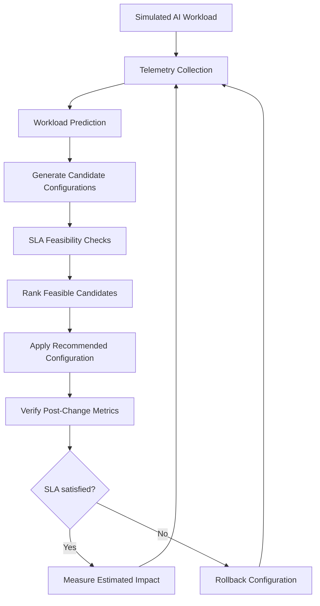

# GPUPilot 🚀
### Autonomous AI Workload Sustainability Controller

GPUPilot is a **simulator-first, vendor-neutral prototype** that demonstrates how AI-serving workloads can be optimized by balancing GPU power, thermal conditions, memory, latency, throughput, and Service Level Agreement (SLA) requirements.

It monitors simulated workload telemetry, predicts the next operating point, evaluates alternative serving configurations, filters out SLA-infeasible candidates, and can apply a recommended configuration with post-change verification and rollback. A continuous controller can repeat this loop with cooldown and minimum-improvement safeguards.

> **Important:** The current hackathon build uses simulated GPU telemetry. It does not read or control physical NVIDIA GPUs. Energy, cooling, and water values are estimates based on configurable assumptions, not real-world measurements.

## Problem Statement

AI workloads are dynamic: request rates and resource requirements change over time. Static serving configurations can waste power and memory during low demand or fail latency and throughput targets during traffic spikes. GPU operators need a way to evaluate configuration changes against both performance constraints and sustainability-related metrics.

## How GPUPilot Works



1. **Monitor:** Collect simulated utilization, power, temperature, memory, request rate, latency, and throughput.
2. **Predict:** Estimate the next workload operating point using a lightweight Random Forest model when enough history is available; otherwise use a trend-based fallback.
3. **Explore:** Evaluate candidate configurations across GPU allocation, batch size, precision, replicas, and concurrency.
4. **Protect SLAs:** Exclude candidates that violate configured latency, throughput, or temperature limits.
5. **Optimize:** Rank feasible candidates using a multi-objective score that includes power, temperature, estimated water impact, and memory.
6. **Verify:** The autopilot can apply a recommendation, check the resulting simulated operating point, and roll back if the SLA fails.
7. **Repeat:** Continuous mode reevaluates periodically, with cooldown and minimum-improvement guardrails to reduce unnecessary switching.

## Features

- **Live dashboard:** Current telemetry, time-series charts, optimization recommendations, controller activity, and before/after comparisons.
- **Five-GPU simulated cluster:** RTX 4090, A100, A100, L40S, and H100 entries. These are simulated devices, not detected physical hardware.
- **Dynamic workload simulation:** Normal, spike, peak, recovery, and custom workload states, including autonomous workload spikes.
- **SLA-aware optimization:** Configurable latency, minimum throughput, and maximum temperature constraints.
- **Configuration search:** Varies precision (FP32/FP16/INT8), batch size, GPU allocation, replicas, and concurrency while respecting the five-GPU simulated capacity limit.
- **Prediction:** Random Forest regression when sufficient samples and dependencies are available, with a deterministic trend fallback.
- **Autopilot:** One-shot and continuous control modes, post-change verification, cooldown, minimum-improvement threshold, and rollback behavior.
- **Sustainability estimates:** Estimated energy, cooling energy, and water impact using configurable PUE/WUE assumptions.
- **Precision quality-gate demo:** Simulated FP16/INT8 quality threshold checks. This does not run model inference or measure actual model accuracy.
- **Hardware/software change monitor:** Can use TinyFish Search when an API key is configured; the displayed hardware/software inventory remains simulated.
- **History and export:** Access telemetry history and export recorded samples.
- **API and tests:** FastAPI/OpenAPI endpoints and automated tests for core simulator, optimizer, prediction, and sustainability behavior.
- **Docker Compose:** Run the backend and dashboard together.

## Technology Stack

| Area | Technologies |
|---|---|
| Backend API | Python, FastAPI, Pydantic, Uvicorn |
| Simulation and optimization | Python, NumPy, custom simulator and optimizer |
| Prediction | scikit-learn Random Forest with trend fallback |
| Frontend | React, Vite, Recharts, Lucide React |
| API documentation | OpenAPI, Swagger UI |
| Testing | pytest |
| Deployment demo | Docker, Docker Compose |
| Optional live release search | TinyFish Search API |

## Getting Started

### Prerequisites

- Python 3.10+ (the included Dockerfile uses Python 3.13)
- Node.js and npm for local frontend development
- Git
- Docker and Docker Compose (optional, for the containerized demo)

### 1. Clone the repository

```bash
git clone https://github.com/MilanSharma-root/GPUPilot.git
cd GPUPilot
```

The backend entry point is `backend.app.main:app`; shared configuration, schemas, services, simulation code, and terminal demos live in their respective packages.

### 2. Start the backend

```bash
python -m venv .venv
```

**Windows PowerShell:**

```powershell
.\.venv\Scripts\Activate.ps1
pip install -r requirements.txt
python -m uvicorn backend.app.main:app --reload --port 8000
```

**macOS/Linux:**

```bash
source .venv/bin/activate
pip install -r requirements.txt
python -m uvicorn backend.app.main:app --reload --port 8000
```

Backend API documentation: <http://127.0.0.1:8000/docs>

### 3. Start the frontend

Open a second terminal from the repository root:

```bash
cd frontend
npm install
npm run dev
```

Open <http://127.0.0.1:5173> in your browser. The frontend uses `VITE_API_URL` when configured; otherwise it defaults to `http://127.0.0.1:8000/api`.

### 4. Run with Docker Compose

From the repository root:

```bash
docker compose up --build
```

- Dashboard: <http://127.0.0.1:5173>
- Backend Swagger UI: <http://127.0.0.1:8000/docs>

### 5. Run tests

From the repository root, after installing backend dependencies:

```bash
pytest -q
```

## API Reference

The complete request/response schemas are available at <http://127.0.0.1:8000/docs> while the backend is running.

| Endpoint | Method | Purpose |
|---|---|---|
| `/api/health` | GET | Backend health check |
| `/api/telemetry` | GET / POST | Read telemetry or control telemetry behavior |
| `/api/history` | GET | Read telemetry history |
| `/api/history/export` | GET | Export history |
| `/api/configuration` | GET / POST | Read or update serving configuration |
| `/api/configuration/evaluate` | POST | Evaluate a proposed configuration |
| `/api/sla` | GET / POST | Read or update SLA thresholds |
| `/api/simulation/start` | POST | Start simulation |
| `/api/simulation/stop` | POST | Stop simulation |
| `/api/simulation/reset` | POST | Reset simulation |
| `/api/simulation/spike` | POST | Trigger a workload spike |
| `/api/simulation/step` | POST | Advance simulation samples |
| `/api/prediction` | GET | Get operating-point prediction |
| `/api/optimize` | GET | Get an optimization recommendation |
| `/api/optimization` | GET | Alternative optimization endpoint |
| `/api/impact` | GET | Get estimated impact and comparison |
| `/api/autopilot/run` | POST | Run a one-shot optimization/control cycle |
| `/api/autopilot` | POST | Run a one-shot autopilot action |
| `/api/autopilot/start` | POST | Start continuous autopilot |
| `/api/autopilot/stop` | POST | Stop continuous autopilot |
| `/api/autopilot/status` | GET | Read controller state |
| `/api/autopilot/events` | GET | Read recent controller events |
| `/api/quality/evaluate` | POST | Evaluate the simulated precision quality gate |
| `/api/quality/status` | GET | Read default simulated quality-gate status |
| `/api/cluster` | GET | Read simulated GPU cluster state |
| `/api/dashboard` | GET | Get consolidated dashboard data |
| `/api/demo/scenario` | GET | Get demo scenario data |
| `/api/demo/comparison` | GET | Get before/after comparison |
| `/api/environment/monitor` | GET | Read hardware/software change-monitor state |
| `/api/environment/scan` | POST | Scan for public release information when configured |

Additional monitoring endpoints are documented in Swagger UI.

## Suggested Demo Flow

1. Start the backend and frontend, then open the dashboard.
2. Start the simulation and observe the live telemetry.
3. Trigger a traffic spike and watch request rate, utilization, power, temperature, latency, and SLA status change.
4. Run **Autopilot** to evaluate alternatives and apply a suitable simulated configuration.
5. Compare the current and optimized configuration and review the estimated sustainability impact.
6. Enable **Continuous** mode to demonstrate repeated workload-aware optimization with safeguards.
7. Optionally open the quality-gate panel and demonstrate simulated threshold PASS/FAIL behavior.

## Sustainability Assumptions

The current default assumptions in `engine/sustainability.py` are:

- **PUE:** 1.20 — facility energy divided by IT energy.
- **WUE:** 0.50 liters per kWh of total facility energy.

Energy, cooling, and water metrics are derived from simulated power and these assumptions. They should be treated as illustrative estimates, not measured consumption or proof of real-world savings.

## Optional TinyFish Search Setup

The dashboard's Hardware & Software Change Monitor can use TinyFish Search to retrieve public release information. The listed driver, CUDA Toolkit, and PyTorch inventory is simulated and is not read from the host machine.

Create an API key through TinyFish, then set it in the same terminal before starting the backend.

**Windows PowerShell:**

```powershell
$env:TINYFISH_API_KEY="your_tinyfish_api_key"
python -m uvicorn backend.app.main:app --reload --port 8000
```

**macOS/Linux:**

```bash
export TINYFISH_API_KEY="your_tinyfish_api_key"
python -m uvicorn backend.app.main:app --reload --port 8000
```

If the key is not configured or the search fails, the monitor should report that condition rather than fabricate results. Verify candidates against official release notes and compatibility requirements before making any real system changes. Do not commit API keys to Git.

## Project Architecture

The repository is organized as a modular monolith so the existing API contract and local launch workflow remain compatible while responsibilities are separated:

```text
GPUPilot-v2-main/
├── backend/
│   ├── app/main.py          # FastAPI application and API endpoints
│   ├── core/config.py       # shared simulator configuration
│   ├── schemas/models.py    # Pydantic/domain models
│   └── services/quality.py  # simulated quality evaluation
├── engine/                  # AI/control logic: prediction, optimization, controller
├── simulation/              # simulator, cluster and environment monitoring
├── scripts/                 # terminal demo scripts
├── frontend/                # React + Vite dashboard
├── data/                    # generated/sample telemetry datasets
├── tests/                   # simulator and API regression tests
├── Dockerfile
├── docker-compose.yml
└── start.bat
```

The project uses a package-based layout: FastAPI code lives in `backend/app`, configuration in `backend/core`, schemas in `backend/schemas`, quality evaluation in `backend/services`, AI/control logic in `engine`, simulation modules in `simulation`, and terminal demos in `scripts`. Root-level Python compatibility wrappers have been removed; imports and startup commands use package paths directly.

Run the API with `python -m uvicorn backend.app.main:app --reload --port 8000`. Run terminal demos with `python scripts/demo_terminal.py` or `python scripts/live_terminal.py`.


## Current Limitations

- All GPU telemetry and the five-GPU cluster are simulated; this build does not detect, monitor, or reconfigure physical GPUs.
- The simulator is not a hardware-accurate GPU performance or power model.
- FP16/INT8 quality-gate results are illustrative simulated values; no model is loaded and no inference or accuracy evaluation is performed.
- Water and cooling impacts depend on assumptions and are not direct measurements.
- NVML/DCGM, vLLM, Triton, Kubernetes, Prometheus, and Grafana are **not integrated** in this version. They are potential future integrations.
- This is a hackathon prototype, not a production cluster scheduler or a guarantee of SLA compliance on real workloads.

## Roadmap

- Integrate NVML/DCGM for real hardware telemetry.
- Connect to an inference runtime such as vLLM or NVIDIA Triton.
- Validate configuration changes using real model-quality and workload benchmarks.
- Add production-grade orchestration, observability, access control, and rollback safeguards.
- Measure energy per request/token and validate environmental estimates against real infrastructure data.

## License

No license is declared here. Add a suitable `LICENSE` file before presenting the repository as open source.

---

**GPUPilot — making AI infrastructure more adaptive, efficient, and sustainability-aware.**
